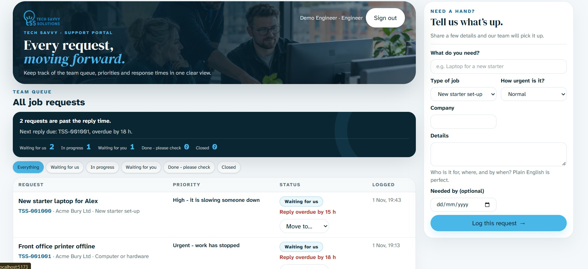

# Tech Savvy Tickets

A job-request ticketing app for Tech Savvy Solutions Ltd. Clients can submit requests and track their own tickets; engineers can view and manage all requests.

## Features

- Role-based access for clients and engineers
- Ticket references and priority-based reply targets
- Microsoft Entra ID sign-in in Azure
- Local demo sign-in for development

## Technology

- **Backend:** Java 25, Spring Boot 4, Spring Modulith (Identity, Ticket, Shared, and Web modules), Spring Security, PostgreSQL, Flyway
- **Frontend:** React 19, TypeScript, Vite, Tailwind CSS
- **Hosting:** Azure Container Apps (API) and Azure Static Web Apps (frontend)

## Preview



## Live demo

[Open the live portfolio demo](https://calm-cliff-05a01740f.3.azurestaticapps.net/demo).

Use either sample account:

| View | Email | Password |
|---|---|---|
| Engineer | `engineer@tss.local` | `Engineer123!` |
| Client | `client@acme.local` | `Client123!` |

The demo login runs in the browser and only selects the demo role. Engineers can view and update the fictional team queue; clients see their fictional requests and can submit a sample request. It does not sign in to Entra, call the Azure API, or use the Azure database. Changes reset when you sign out, leave, or refresh. These credentials are public and must not be reused for real accounts or sensitive data. The full app at the site root uses Microsoft Entra ID and requires an assigned **Engineer** or **Client** role.

The Static Web App hostname can change if the resource is deleted and recreated. If that happens, use the new URL printed by the launcher and update the live demo link above.

## Azure deployment

The Azure website address is generated when the resources are provisioned. The launcher prints the address; see the [deployment guide](docs/DEPLOYMENT-GUIDE.md) for prerequisites, what the launcher changes, verification, and troubleshooting. The public demo link is in the [Live demo](#live-demo) section; the full application at the site root remains Entra-protected.

To reset the live Azure database back to a known sample state, run the script in `dbscripts/azure-reset-and-seed.sql` in IntelliJ with the Azure `tickets` database connection selected. It truncates the live ticket, requester, and company tables and reseeds sample data. Use it only on the Azure database, and update the requester identity values in the script if a different Entra account should own the seeded tickets.

## Run locally

Install JDK 25, Node.js 22, and Docker Desktop, and make Maven available on `PATH` (or use IntelliJ's Maven tool window to run Maven goals). From the project root, start the database:

```powershell
docker compose up -d
```

In a PowerShell terminal, start the backend with the local profile:

```powershell
$env:SPRING_PROFILES_ACTIVE = "local"
mvn -pl backend spring-boot:run
```

In another terminal, install frontend dependencies and start Vite:

```powershell
cd frontend
npm ci
npm run dev
```

Open [http://localhost:5173](http://localhost:5173). Sign in with one of these local demo accounts:

| Role | Email | Password |
|---|---|---|
| Engineer | `engineer@tss.local` | `Engineer123!` |
| Client | `client@acme.local` | `Client123!` |

These accounts authenticate against the local development backend. The same email and password pairs are shown on the public `/demo` page, where they only select a role for fictional browser-only data; they are not real accounts and do not authenticate to Azure. The full app at the website root requires Microsoft Entra sign-in.

## Run tests

Run from the project root:

```powershell
mvn -B -pl backend verify
```

Run frontend checks from `frontend`:

```powershell
npm ci
npm run typecheck
npm test
npm run build
```

The backend integration tests use Testcontainers and require Docker to be running and accessible. Backend commands require JDK 25 because the project uses Java 25 preview features, plus Maven. The frontend test/build commands require Node.js 22.

## Deployment

After pushing the project and workflow files to `main`, run `.\infra\azure-run-bicep.cmd` from IntelliJ's PowerShell terminal at the project root. It provisions or reconciles the configured Azure resources, configures Entra and GitHub Actions, and queues both deployments. It installs Azure CLI and GitHub CLI with `winget` if needed; browser sign-in may be required the first time. The launcher prints the website and API addresses. It targets this project's configured live Azure subscription and resource group; it is not a staging-only test command. Keep the same Windows account and PC so it can access the locally encrypted database passwords. Read the [deployment guide](docs/DEPLOYMENT-GUIDE.md) before running it.

To remove the Azure resource group, run `.\infra\azure-run-bicep.cmd -Cleanup` and confirm the prompt. This does not delete the Entra app registrations or GitHub repository settings.
