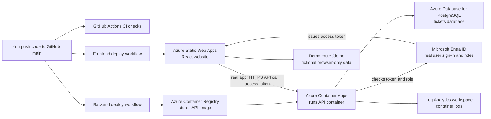

# Tech Savvy Tickets: Azure deployment, explained simply

This guide explains what the project deploys, what each part does, how the parts talk to each other, and how to repeat the setup. It describes the files currently in this repository; it is not a general Azure course.

You do **not** need to memorise every Azure portal page to discuss this in an interview. The useful thing is to understand the journey from a code change to a working request, and to be honest about what you built and what you would improve before using it for real customers.

## First: what should a full-stack developer know about cloud and DevOps?

There is no single requirement for every full-stack job. In general, you should be ready to explain how your application is built, tested, configured, deployed, authenticated, and investigated when it fails. You should know the basics of Git, CI/CD, HTTP, environment settings, logs, databases, and the cloud service your own application uses. A team may have a platform or DevOps group that owns the deeper infrastructure work.

Recent UK job descriptions show that range. A junior developer vacancy says cloud exposure and personal projects count; a senior full-stack vacancy asks for experience supporting applications hosted in Azure and working with delivery pipelines; cloud/platform vacancies expect hands-on infrastructure-as-code, identity, networking, monitoring, and automation. Those are different jobs, so do not assume every full-stack developer is expected to be an Azure administrator. [Junior developer example](https://uk.indeed.com/viewjob?jk=87990ef18a29af4a), [CAA senior full-stack example](https://careers.caa.co.uk/job/Gatwick-Senior-Full-Stack-Developer-Web/1448661733/), [Junior Azure Engineer example](https://jobs.computacenter.com/job/London-Junior-Azure-Engineer-ENG-SE1-8HL/1238376401/).

Using a coding agent is a reasonable way to learn and build, if the employer allows it. The responsibility still belongs to you: review the generated changes, run the checks, understand the important decisions, protect credentials, and be able to investigate failures. Some employers have rules about which tools and data may be used. A recent senior developer listing explicitly asks for responsible AI-assisted engineering, while a specialist agentic role asks candidates to work with agents as a core part of the job. [Accenture role example](https://www.accenture.com/gb-en/careers/jobdetails?id=R00357194_en), [agentic developer role example](https://careers.umain.com/jobs/8574406-full-stack-agentic-developer).

A truthful interview answer could be:

> “I deployed a full-stack portfolio app to Azure. I used a coding agent to help me work through the infrastructure and deployment code, then reviewed and ran the setup. Bicep describes the Azure resources; a PowerShell launcher configures Azure and GitHub; GitHub Actions tests and deploys the frontend and API. Microsoft Entra handles real-user sign-in, the API checks the token and role, and PostgreSQL stores the real tickets. I can explain the flow and the demo’s security and availability limits.”

That is a stronger answer than claiming you typed every command from memory.

## The whole system in one picture



The solid idea to remember is: **GitHub ships the code; Bicep describes the cloud resources; the browser uses the website and API.**

## What was provisioned?

The resource group is `rg-tss-tickets-pmc01`. Think of it as a labelled folder in the Azure subscription. It contains the Azure resources below. The successful run recorded in this project printed the website as [calm-cliff-05a01740f.3.azurestaticapps.net](https://calm-cliff-05a01740f.3.azurestaticapps.net) and the API as [tickets-api.graystone-1e8b22c1.uksouth.azurecontainerapps.io](https://tickets-api.graystone-1e8b22c1.uksouth.azurecontainerapps.io). Use the latest addresses printed by the launcher if they change; generated hostnames can change if a resource is deleted and recreated.

| Resource | Name | Region | In plain English |
|---|---|---|---|
| Azure Container Registry (ACR) | `tssacrpmc01` | UK South | A private shelf for versioned API container images. GitHub Actions uploads a built image here; the API runtime pulls it from here. The registry admin account is disabled. |
| PostgreSQL Flexible Server | `pg-tss-pmc01` | UK South | The managed PostgreSQL database server. It hosts the database called `tickets`, where the real app’s ticket records live. |
| Container Apps environment | `cae-tss-pmc01` | UK South | The managed area in which the API container runs. It is connected to the Log Analytics workspace for logs. |
| Container App | `tickets-api` | UK South | The running Spring Boot API. It has HTTPS ingress, listens inside the container on port 8080, and connects to PostgreSQL. |
| Log Analytics workspace | `law-tss-pmc01` | UK South | A place to collect and search the Container Apps environment’s logs when diagnosing the API. |
| Static Web App | `swa-tss-pmc01` | East US 2 | Hosts the built React website and serves it to browsers. The app files can be served globally; this is the Azure resource’s selected region. |

The templates declare an ACR Basic registry with its admin user turned off; PostgreSQL 17 on a small burstable `Standard_B1ms` tier with 32 GB auto-growing storage, seven-day backup retention, and high availability disabled; a Free Static Web App; and an externally reachable Container App with 0.5 CPU, 1 GiB memory, HTTPS ingress to container port 8080, one active revision at a time, and a scale range of zero to two replicas. The Log Analytics workspace retains logs for 30 days. Its daily ingestion cap is set to unlimited (`-1`), which does **not** mean log ingestion is free. The API's `/actuator/health` endpoint is public for health checks; application API routes require an allowed role.

### What each part does when someone uses the app

1. The browser downloads the React files from the Static Web App.
2. At the site root, the user signs in with Microsoft Entra ID. The app requests an access token for this API.
3. The browser sends an HTTPS request to `tickets-api` with that token in the `Authorization: Bearer ...` header.
4. The API checks that the token came from the configured tenant, is meant for this app, and contains an allowed app role. It maps the `ENGINEER` and `CLIENT` roles to API permissions. For example, changing ticket status requires the Engineer role.
5. The API reads or changes ticket rows in PostgreSQL over a TLS-required database connection. Flyway creates the table and indexes from the versioned SQL migration when the API starts; Hibernate checks that the schema matches.
6. The Container Apps environment sends container output and platform events to Log Analytics.

The `/demo` page is different. Its sample tickets and demo sign-in are created in the website’s browser code. They are fictional, do not call the API or database, and reset when you leave or refresh. The demo role selector is for showing the interface; it is **not** an authentication or security system. The full app at `/` uses Entra and the live API.

### Why CORS caused the earlier “Failed to fetch” problem

The website and API have different hostnames, so a browser treats them as different origins. Before allowing the browser to read the API response, the API must return an `Access-Control-Allow-Origin` header matching the website’s exact origin, such as `https://calm-cliff-05a01740f.3.azurestaticapps.net`. The API’s CORS allowlist is set by `CORS_ALLOWED_ORIGINS` in `azure-setup-2.bicep`; the launcher takes the current hostname from the Static Web App resource. If the site hostname changes or the API has an old value, the browser reports a CORS or “Failed to fetch” error. CORS is a browser rule, not a login: the API still separately checks the Entra access token and role.

## Three different identities — do not mix them up

There are three separate identity jobs here:

1. **A person signing in to the app:** the `Tech Savvy Tickets` Entra app registration defines the sign-in settings, the `tickets.access` API scope, and the `ENGINEER` and `CLIENT` app roles. The launcher configures the local and current website redirect addresses, requires users to be assigned a role, grants consent for the API scope, and assigns the person running setup the Engineer role. A new permitted user must be assigned a role in the Enterprise application; simply having an Entra account is not enough.
2. **GitHub Actions deploying to Azure:** the `gh-deploy-tss-pmc01` Entra app and service principal let the workflow deploy. Azure trusts a short-lived GitHub OpenID Connect (OIDC) token for this repository’s `main` branch. There is no long-lived Azure client password stored in GitHub for this login. Its permissions are Contributor on the project resource group and AcrPush on ACR. GitHub’s OIDC approach is designed to avoid storing long-lived cloud credentials. [GitHub’s Azure OIDC guide](https://docs.github.com/en/actions/how-tos/secure-your-work/security-harden-deployments/oidc-in-azure).
3. **The API container pulling its image:** the Container App has its own system-assigned managed identity. Azure grants it AcrPull on ACR so it can download the private image. This is not the user’s Entra login and not the GitHub deployment identity.

The launcher saves GitHub Actions settings for the repository. `AZURE_CLIENT_ID`, `AZURE_TENANT_ID`, and `AZURE_SUBSCRIPTION_ID` are identifiers the workflow passes to Azure login; they are not passwords. `AZURE_STATIC_WEB_APPS_API_TOKEN` is an actual deployment credential and belongs in GitHub Secrets. Resource names and URLs are GitHub Actions Variables.

The other Actions Variables are `ACR_NAME`, `ACA_APP_NAME`, `AZURE_RESOURCE_GROUP`, `VITE_API_BASE_URL`, `VITE_ENTRA_TENANT_ID`, and `VITE_ENTRA_CLIENT_ID`. The `VITE_...` values are inserted into the website at build time and are visible to anyone who downloads its JavaScript, so they must contain only public configuration such as hostnames and application IDs. The PostgreSQL password is **not** put in GitHub or the repository; it is kept in the local encrypted file and Azure Container App secret described above.

## How the setup files fit together

You have one entry point and three Bicep files:

| File | Job |
|---|---|
| `infra/azure-run-bicep.cmd` | The easy-to-run Windows entry point. It starts the PowerShell script beside it. |
| `infra/azure-run-bicep.ps1` | Orchestrates sign-ins, identity configuration, password handling, Bicep deployments, GitHub settings, and workflow runs. |
| `infra/azure-setup-1.bicep` | Subscription-level Bicep entry point. It creates the resource group and calls the resource template. |
| `infra/azure-setup-1-resources.bicep` | Declares the registry, database, environment, placeholder API app, workspace, Static Web App, and Azure role assignments. |
| `infra/azure-setup-2.bicep` | Applies the real API runtime settings: image, database connection, Entra IDs, secret reference, ingress, and CORS origin. |

Run the `.cmd` launcher. Do **not** open and deploy the Bicep files one at a time: the launcher supplies secure values and passes the current API image into the second deployment.

## What happens during a fresh setup, in order

The first setup is automated, but it still needs the right accounts and initial browser sign-ins. The launcher cannot create your GitHub account, give your Azure user permissions, or silently approve a browser login.

### Before you press Run

- The project must be cloned from the GitHub repository, and the setup files plus workflows must be pushed to its `main` branch. The launcher does not create the repository or push code.
- This launcher is configured for this project’s Azure tenant and subscription, suffix `pmc01`, UK South core resources, East US 2 Static Web App, and `main` branch. It can be repeated for this project in that account; another person deploying a fork into a different Azure subscription must configure their own tenant/subscription and names first.
- You need a Windows computer with IntelliJ, PowerShell, Git, and `winget`. The launcher can install Azure CLI and GitHub CLI with `winget` if they are missing.
- Your Azure sign-in must have enough permission in the project’s configured tenant and subscription to create the resources, register apps, assign roles, and grant the requested tenant-wide API consent.
- Your GitHub account must be allowed to update Actions secrets and variables for the repository.

### Run it

1. Open the cloned project in IntelliJ.
2. Open IntelliJ’s PowerShell terminal at the project root.
3. Run:

   ```powershell
   .\infra\azure-run-bicep.cmd
   ```

4. On first use, complete the Azure and GitHub browser sign-ins if they appear. Azure CLI selects the tenant and subscription configured for this project. Those interactive sign-ins are the human part of first-time setup; you should not need to hand-create portal resources or paste the Actions settings yourself.
5. Let the launcher finish. It checks the templates, creates or reconciles resources, configures Entra and GitHub, and queues the API and website deployment workflows.
6. Open GitHub → **Actions** and wait for both **Deploy API to Azure Container Apps** and **Deploy web app to Azure Static Web Apps** to finish successfully. “Setup complete” means the workflows were queued; it does not mean the workflows have already passed.
7. Use the printed website and API addresses for the checks below.

### What the launcher does behind the scenes

1. Finds Azure CLI and GitHub CLI, installing either with `winget` if necessary. It checks Azure is signed in to the project’s expected tenant and subscription and GitHub is signed in to the repository owner’s account.
2. Reads repository identity from GitHub so the Azure OIDC trust is for the right repository and branch.
3. Creates or repairs the GitHub deployment app, its federated trust, and its Azure permissions.
4. Creates or repairs the `Tech Savvy Tickets` user app registration: API scope, roles, token settings, redirect URLs, consent, and the current user’s Engineer assignment. It runs once before the website URL exists and again after Azure returns the current hostname.
5. Creates a random PostgreSQL admin password if this Windows profile does not already have one. Windows encrypts it for that user under `%LOCALAPPDATA%\TechSavvyTickets`. The password is not committed to the repository. Azure Container Apps receives it as an app secret; the API reads it through a secret reference at runtime.
6. Registers required Azure resource providers and builds the Bicep templates to catch syntax errors before deployment.
7. Deploys `azure-setup-1.bicep`, which creates the resource group and core services. On a truly empty install, the API container starts briefly with Microsoft's simple quickstart image; the backend workflow later replaces it with the real API image. On an existing install, the launcher first reads the current API image so the initial template does not accidentally replace it with the temporary quickstart image.
8. Deploys `azure-setup-2.bicep` to set the API’s real configuration and exact website CORS origin.
9. Writes GitHub Actions secrets and variables, then queues both deployment workflows.

## What happens after setup: code deployment

The Bicep templates provision infrastructure. GitHub Actions builds and deploys application code. Those are connected jobs, but they are not the same job.

- **API workflow:** on a push to `main` that changes `backend/**` or the API workflow, GitHub runs `mvn -B verify`. If it passes, it builds a Docker image from `backend/Dockerfile`, tags it with the commit SHA, pushes it to ACR, and tells Azure Container Apps to run that image. Container Apps creates a new revision. The workflow can also be started manually.
- **Website workflow:** on a push to `main` that changes `frontend/**` or the website workflow, GitHub installs Node dependencies, runs frontend tests, builds the React website with the current API and Entra settings, and uploads `frontend/dist` to Static Web Apps. It can also be started manually.
- **CI workflow:** on pull requests and pushes to `main`, the separate CI workflow runs the backend verification and frontend typecheck, tests, and build. The deploy workflow has its own checks as described above.
- **Infrastructure changes:** changing a `.bicep` file alone does not make these workflows deploy infrastructure. Run the launcher to apply the infrastructure templates and refresh configuration.

## Is Bicep idempotent? What if I run the launcher again?

Yes: Bicep is declarative and idempotent. In ordinary words, it says what the resources should look like. Deploying it again with the same names and values normally updates/reconciles those resources in place; it does not first delete the resource group and start over. Microsoft describes repeated Bicep deployments as producing the same declared resource state. [Bicep overview](https://learn.microsoft.com/en-us/azure/azure-resource-manager/bicep/overview).

For this project, rerunning the launcher:

- keeps the same resource group and resource names;
- reapplies settings that the templates declare, so a manual change to a declared setting might be set back to the template’s value;
- does not intentionally delete the PostgreSQL database or its rows;
- reuses the password encrypted for the same Windows account; a different Windows profile or PC creates a new password and configures Azure with it;
- reruns the API and website deployments.

The launcher captures the current API image before deploying the first template and passes that image to the second. This matters because Bicep describes the whole Container App; a careless reapply with the placeholder image could roll the API back.

The cleanup option is separate and destructive. From the project root, `.\infra\azure-run-bicep.cmd -Cleanup` asks you to type `DELETE`, then starts deleting the whole resource group in the background. That also removes the PostgreSQL server and its data. It does **not** delete the Entra app registrations or GitHub repository settings.

## How to check that it worked

1. **GitHub Actions:** both deployment workflows finish green. If setup printed “complete” but one is red or still running, the app may not be ready yet.
2. **API health:** open the printed API address with `/actuator/health` appended. Expect a JSON response containing `"status":"UP"`. The app can take a short time to wake from zero replicas.
3. **Portfolio demo:** open the website URL plus `/demo`. Use the public sample accounts shown in the README. They only select a fictional browser-side role; they are not Entra accounts.
4. **Real application:** open the website root. Sign in with a real account in the configured Entra tenant that has an Engineer or Client app role. The launcher assigns Engineer to the person who ran setup. For another user, open Entra ID → Enterprise applications → **Tech Savvy Tickets** → **Users and groups** and assign the correct role.
5. **Database path:** in the real app, create a sample ticket, refresh, and confirm it remains. This uses the API and PostgreSQL; the `/demo` page does not.
6. **Logs:** in Azure Portal, open the resource group → `tickets-api` → **Monitoring → Log stream** for live container output, or open `law-tss-pmc01` to query collected logs. Azure notes that workspace queries can take several minutes to receive new logs. [Container Apps logging](https://learn.microsoft.com/en-us/azure/container-apps/logging).

## Important limits: this is a portfolio/demo deployment

The app is working, but “working” does not mean “ready for a company’s real customer data.” The current templates deliberately keep this setup small and straightforward. Know these limits if asked about it:

- **Database networking:** PostgreSQL public network access is enabled, with a `0.0.0.0` to `0.0.0.0` firewall rule named `AllowAzureServices`. Microsoft says this allows connections from Azure services across Azure, including other customers’ subscriptions; it is not restricted to this resource group. A production design should use private networking or a narrowly scoped network rule and maintain strong authentication. [PostgreSQL firewall explanation](https://learn.microsoft.com/en-us/azure/postgresql/security/security-firewall-rules).
- **Database account:** the API is configured with the PostgreSQL server’s `tickets` administrator login. For production, create a separate application database user with only the permissions it needs; do not let an application use the server administrator account.
- **Secret management:** the database password is encrypted for the Windows user locally and placed in the Container App secret store. For a multi-person production environment, use a shared managed secret system such as Azure Key Vault with a managed identity and a controlled rotation process.
- **Availability and scale:** PostgreSQL high availability is disabled, the backup retention in the template is seven days, and the Container App can scale to zero and at most two replicas. Scaling to zero can mean a delay on the first request after inactivity. There is no tested disaster-recovery plan here.
- **Logging cost:** Log Analytics retention is 30 days and its ingestion cap is unlimited. That is convenient for a demo but should have cost monitoring and an agreed retention/ingestion budget in a production environment.
- **Network architecture:** the app uses public HTTPS endpoints and does not define a private VNet, private database endpoint, private registry endpoint, or production web application firewall in these templates.
- **Human approval and governance:** the launcher gives the GitHub deployment identity Contributor at the resource-group scope so the workflow can update the app. A company may require narrower permissions, protected deployment environments, approvals, policy checks, or separate staging and production environments.

These are useful interview talking points: you can explain what works, identify the trade-offs, and describe a sensible next hardening step without claiming the demo has controls it does not have.

## Five things to remember for an interview

1. **Bicep is infrastructure-as-code:** resource names and desired settings live in version-controlled files.
2. **The launcher is the orchestrator:** it handles sign-in, Entra/GitHub setup, secret handling, Bicep deployment, and queues code deployment. It is Windows-specific because it is a `.cmd`/PowerShell launcher.
3. **GitHub Actions is CI/CD:** it checks code, builds the API image or website bundle, and deploys them after a push to `main`.
4. **There are separate trust boundaries:** Entra authenticates app users; GitHub OIDC authenticates a workflow to Azure; the Container App managed identity pulls from ACR.
5. **The real request flow:** browser → Static Web App → Entra access token → Container App API → PostgreSQL. The API validates identity and role; CORS only controls which browser origins can read cross-origin responses.

## Small glossary

| Word | Meaning here |
|---|---|
| Resource group | A named grouping used to manage related Azure resources together. |
| Bicep | Azure’s declarative language for describing resources and their settings. |
| Idempotent | Repeating the same deployment reconciles the declared state rather than starting from an empty environment. |
| CI/CD | Automated checks/builds and automated delivery of changes. |
| Container image | A packaged copy of the API application plus its runtime. |
| Container registry | A store for container images; here that is ACR. |
| Container | A running instance of an image; here Azure Container Apps runs it. |
| Revision | A version of a Container App configuration and image. |
| OIDC federation | A way for GitHub Actions to prove its identity to Azure using short-lived tokens rather than a stored Azure password. |
| Managed identity | An Azure-managed identity a service can use to access another Azure service without storing a password in application code. |
| App role | A named permission assigned to a person, such as Engineer or Client. |
| CORS | A browser rule that controls whether a website origin may read responses from a different origin. It does not authenticate API users. |
| Environment variable | A setting supplied to the running API, such as the database host or Entra tenant ID. |
| Secret | Sensitive data such as a database password or deployment token; do not commit it to Git. |

## Official reading if you want to go one step deeper

- [What is Bicep?](https://learn.microsoft.com/en-us/azure/azure-resource-manager/bicep/overview)
- [Azure Container Apps overview](https://learn.microsoft.com/en-us/azure/container-apps/overview)
- [Azure Container Registry overview](https://learn.microsoft.com/en-us/azure/container-registry/container-registry-intro)
- [Azure Database for PostgreSQL Flexible Server overview](https://learn.microsoft.com/en-us/azure/postgresql/flexible-server/overview)
- [Azure Static Web Apps documentation](https://learn.microsoft.com/en-us/azure/static-web-apps/)
- [GitHub Actions OIDC with Azure](https://docs.github.com/en/actions/how-tos/secure-your-work/security-harden-deployments/oidc-in-azure)
